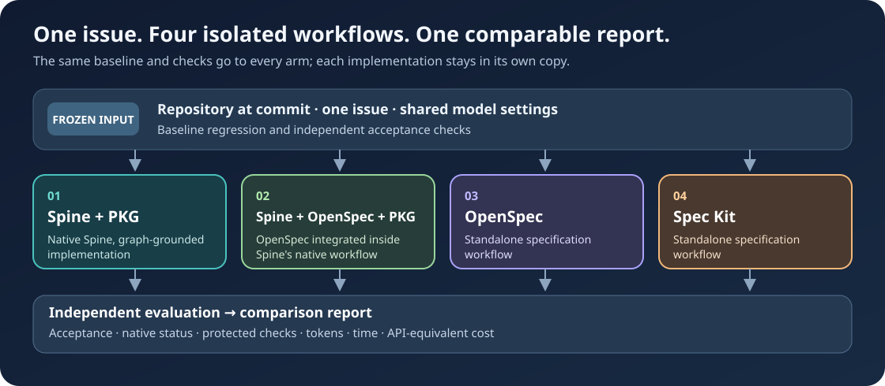

# Spine Harness

**Compare four specification-to-code workflows across multiple issues and repositories.** For each issue, Spine Harness gives every workflow the same committed repository baseline, task, model settings, and checks. It records each result, then combines compatible issue runs into a study.



## The four workflows

| Workflow | Context used for implementation | v19 tool pin |
| --- | --- | --- |
| **Spine + PKG** | Spine's Product Knowledge Graph grounds the native feature workflow. | Spine `v3.57.1`; PKG is included. |
| **Spine + integrated OpenSpec + PKG** | Spine's feature workflow also uses its integrated OpenSpec path. | Spine `v3.57.1`; the integration and PKG are included. |
| **OpenSpec** | Standalone OpenSpec workflow. | OpenSpec CLI `1.14.1`. |
| **Spec Kit** | Standalone spec-kit workflow. | Spec Kit `v1.0.11`. |

Each arm works in a separate disposable copy of the target repository. The four-arm runner takes one saved issue per configuration; use fresh configurations and result directories for additional issues, then [combine compatible runs](docs/FRAMEWORK_MATRIX.md#compare-multiple-tasks). The 33-scenario reference matrix schedules many tasks automatically, and the historical two-arm Jira runner accepts an issue list in one configuration.

Graphify and codebase memory are candidates for future tool integrations, not included arms in v19. The harness supports [external command adapters](docs/FRAMEWORK_MATRIX.md); each new integration needs its own version pin, preflight, and comparable evidence before joining a study.

Reports keep workflow completion, Spine's native validation, regression checks, independent acceptance, changed protected checks, tokens, time, and API list-price equivalent cost distinct. A passing check covers the selected behavior; it does not certify the whole issue.

## Run issues across repositories

1. **Set up the tools.** Follow the [macOS handover](docs/portable/macos/QUICKSTART.md) or [Windows/WSL2 setup](docs/portable/windows/SETUP_WSL.md). The harness uses Python 3.12, Git, uv, OpenSpec, a pinned Spine tools checkout, and a Codex CLI sign-in with access to the chosen model.
2. **Freeze each task.** Copy [the four-arm example configuration](examples/framework-matrix.example.json) for each issue. Give it a unique `name` and set `source_repo`, a pre-fix `baseline` commit, the saved issue in `task_file`, the application's Python interpreter, and `required_grounding`. Configure regression `checks` that pass on the baseline and independent `acceptance_checks` that expose the missing behavior. The [qualification guide](docs/MATRIX_QUICKSTART.md) walks through the first task; the [framework reference](docs/FRAMEWORK_MATRIX.md) covers further tasks and repositories.
3. **Check before spending model tokens.** For each configuration, run `doctor` to verify the local tools, then `prepare` to freeze that task and check its baseline. The optional `doctor --smoke-model --approved` makes a small model call. Review the prepared evidence before starting the four arms.
4. **Run and combine results.** Follow the [run and report steps](docs/MATRIX_QUICKSTART.md#3-sign-in-prepare-then-run) for each prepared issue. Each result directory contains a comparison report, per-arm outcomes, patches, and usage evidence. When compatible runs close, use [the multi-task study command](docs/FRAMEWORK_MATRIX.md#compare-multiple-tasks) to aggregate them. A setup defect stops that comparison; a workflow failure under a valid setup remains a reported result.

From a source checkout, set `PYTHONPATH="$PWD/src"` before running harness commands. For example, after two issues have closed:

```bash
python3 -m spineharness.matrix_study --results results/issue-a results/issue-b \
  --output results/multi-issue-study
```

The [documentation index](docs/README.md) covers the packaged archives and all other commands. The original application checkout and issue tracker are read-only during measurement.

To create macOS and Windows/WSL2 release archives, follow the [release build guide](docs/BUILD_RELEASES.md). Generated archives go in the ignored `dist/` directory.

## Other study modes

- [33-scenario reference matrix](docs/QUICKSTART.md): a larger four-arm study after the one-issue pilot.
- [Matched context comparison](docs/CONTEXT_MATRIX.md): vary framework context while holding the implementation step fixed.
- [Scenario catalog](docs/SCENARIOS.md): add or validate reference tasks and held-out checks.
- [Historical two-arm Jira workflow](docs/JIRA_BENCHMARK.md): reproduce the earlier protocol without pooling its results with the four-arm matrix.

Current runtime and release validation details are in the [release notes](docs/releases/RELEASE_VALIDATION_V19.md). Harness modules live in `src/spineharness/`, offline tests in `tests/`, and current guides in `docs/`.
